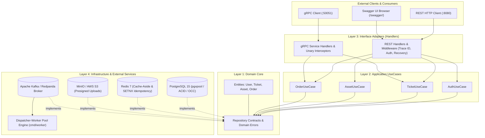
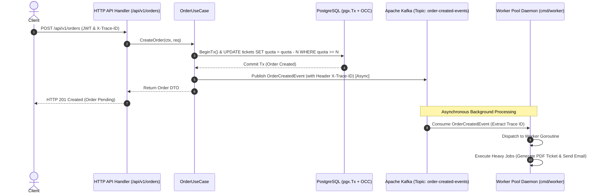
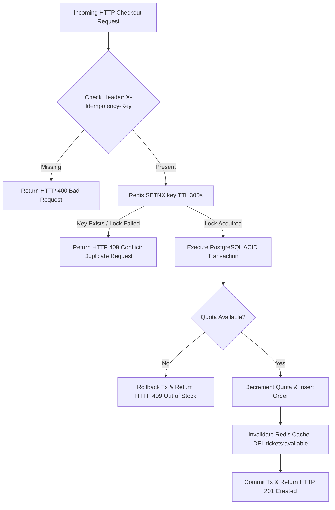

# Enterprise Go Ticketing Engine

Production-grade, cloud-native backend service built with Go, adhering strictly to Clean Architecture principles, zero-ORM data persistence, event-driven message queuing, distributed idempotency, and advanced concurrency patterns.

---

## 🏛 System Architecture & Design Diagrams

The project is structured according to **Clean Architecture (Onion/Hexagonal)** principles to ensure domain isolation, high testability, and strict adherence to the **Dependency Inversion Principle (DIP)**:

1. **Domain Layer (Core):** Pure business entities, domain errors, and repository contracts. Zero external dependencies.
2. **UseCase Layer (Application):** Business logic orchestration, validation rules, and transaction boundaries.
3. **Handler Layer (Interface Adapters):** RESTful HTTP endpoints, gRPC services, middleware, and request/response DTO mappings.
4. **Infrastructure Layer (External):** Database persistence (`pgxpool`), Redis caching/locking, S3-compatible BLOB storage, Kafka message broker, and background workers.

### 1. High-Level Clean Architecture & Dual-Protocol Entry Points



---

### 2. Event-Driven Asynchronous Pipeline (Order Processing)



---

### 3. Redis Cache-Aside & Distributed SETNX Idempotency Flow



---

## 🛠 Tech Stack

* **Language & Runtime:** Go 1.22+
* **Database & Storage:** PostgreSQL 15+ (`pgxpool`), MinIO / AWS S3 SDK v2
* **Caching & Distributed Locks:** Redis 7 (Atomic `SetNX`, Cache-Aside Pattern)
* **Message Broker:** Apache Kafka (Segment I/O `kafka-go`)
* **Communication Protocols:** RESTful APIs (Chi Router), gRPC & Protocol Buffers (`protoc-gen-go-grpc`), OpenAPI 3.0 / Swagger UI
* **Observability & Profiling:** Go `log/slog` (JSON structured logging), Distributed Tracing (`X-Trace-ID`), Runtime Profiling (`net/http/pprof`)
* **Testing & Quality Audit:** `testify/mock`, k6 Load Testing Engine (Grafana k6), Go Race Detector (`-race`)
* **Infrastructure & Containerization:** Docker, Docker Compose, Kubernetes Manifests (`Deployment`, `Service`, `ConfigMap`, `Ingress`, `Secret`)

---

## 🚀 Quick Start & Execution Guide

### Option 1: Local Development with Docker Compose

1. **Clone Repository & Copy Environment Configuration:**
   ```bash
   cp .env.example .env
   ```

2. **Start Infrastructure Services (Postgres, Redis, MinIO, Kafka):**
   ```bash
   docker compose up -d
   ```

3. **Run API Server & Worker Background Daemon:**
   ```bash
   # Terminal 1: REST & gRPC API Server
   go run cmd/api/main.go

   # Terminal 2: Asynchronous Background Worker
   go run cmd/worker/main.go
   ```

4. **Access Endpoints & Documentation:**
   * **REST API:** `http://localhost:8080`
   * **Swagger UI:** `http://localhost:8080/swagger/index.html`
   * **gRPC Endpoint:** `localhost:50051`
   * **Runtime Profiling (`pprof`):** `http://localhost:8080/debug/pprof/`

---

### Option 2: Kubernetes Deployment (Production Manifests)

Deploy the full stack onto any Kubernetes cluster (Minikube / Kind / EKS / GKE):

```bash
# 1. Apply Secret & ConfigMap Configuration
kubectl apply -f deployment/k8s/secret-example.yaml
kubectl apply -f deployment/k8s/configmap.yaml

# 2. Deploy Dual-Protocol API Server & Background Worker
kubectl apply -f deployment/k8s/api-deployment.yaml
kubectl apply -f deployment/k8s/worker-deployment.yaml

# 3. Apply Cluster IP Service & NGINX Ingress Controller
kubectl apply -f deployment/k8s/api-service.yaml
kubectl apply -f deployment/k8s/ingress.yaml

# 4. Verify Pod Health & Probes
kubectl get pods -w
```

---

## 🧪 Testing & Performance Benchmarks

### 1. Table-Driven Unit Tests & Concurrency Audit
```bash
# Execute unit tests with code coverage audit
go test -v -cover ./...

# Concurrency race condition audit
go test -race ./...
```

### 2. High-Throughput k6 Stress Testing
```bash
# Run 100 Virtual Users (VUs) Flash Sale Simulation
k6 run script/k6/checkout_stress_test.js
```

**SLA Benchmark Results (100 Concurrent VUs):**
* **Throughput:** ~422.6 Requests Per Second (RPS)
* **P95 Latency:** `6.90 ms` (SLA threshold: `< 500 ms`)
* **P99 Latency:** `12.36 ms` (SLA threshold: `< 1000 ms`)
* **HTTP Error Rate:** `0.00%` (100% assertions passed)

---

## 📋 Technical Features & Implementation Checklist

* [x] Project Infrastructure & Core Utilities
    * [x] Structured JSON logging setup (`log/slog`)
    * [x] Environment configuration loading (`godotenv`)
    * [x] Graceful shutdown handling (`SIGINT`, `SIGTERM`)
    * [x] Runtime profiling integration (`pprof`)
* [x] Layer 1: Domain Layer
    * [x] Core domain entities (`User`, `Ticket`, `Asset`, `Order`)
    * [x] Repository abstraction contracts & domain errors
* [x] Layer 4: Infrastructure / Repository Layer
    * [x] Connection pool initialization using `pgxpool`
    * [x] PostgreSQL implementation for `UserRepository`
    * [x] PostgreSQL implementation for `TicketRepository`
    * [x] PostgreSQL implementation for `OrderRepository`
    * [x] PostgreSQL & S3-compatible implementation for `AssetRepository`
* [x] Layer 2: UseCase Layer
    * [x] User authentication & management logic
    * [x] Ticket booking & concurrency control logic
    * [x] Ticket event creation & inventory browsing logic
    * [x] Asset upload orchestration & status management
* [x] Layer 3: Interface Adapters (Handlers)
    * [x] REST API endpoints with HTTP Health Probes (`/healthz`, `/readyz`)
    * [x] JWT Authentication Middleware for route protection
    * [x] gRPC services & Protobuf definitions
    * [x] gRPC Handlers & Unary Interceptors (Tracing, Logging, Recovery)
* [x] Product & Asset Service
    * [x] AWS S3 / MinIO integration (Pre-signed URL for Govt. ID Card upload)
    * [x] S3-compatible client implementation using AWS SDK for Go v2
    * [x] Decoupled BLOB storage architecture with PostgreSQL metadata tracking
    * [x] Two-phase upload workflow (`PENDING` -> `UPLOADED` state transition)
    * [x] Clean Architecture layer separation (Domain, UseCase, Handler, Repository)
* [x] Order, Event-Driven & Caching
    * [x] Core order domain entities & repository abstraction contracts
    * [x] ACID Database Transactions (`pgx.Tx`) & Optimistic Concurrency Control (OCC)
    * [x] Distributed Caching & Idempotency Key (Redis Cache-Aside Pattern)
    * [x] Enterprise Centralized Config (`internal/config`)
    * [x] Distributed Idempotency Key Engine (Redis Atomic `SetNX` + TTL)
    * [x] Message broker integration (Apache Kafka)
    * [x] Modular Dispatcher-Worker pattern implementation
    * [x] Background job execution (email notifications, PDF ticket generation)
* [x] Observability, Testing & Cloud-Native
    * [x] Middleware Context & Distributed Tracing (`Trace ID`)
    * [x] Kafka Header Trace ID Propagation for asynchronous background workers
    * [x] Unit Testing Architecture & Mocking Strategy (`testify/mock`)
    * [x] Table-Driven Unit Testing for Core Business Logic (`OrderUseCase` & `UserUseCase`)
    * [x] Code Coverage Audit (50-70%+) & Concurrency Race Audit
    * [x] gRPC Handlers, Unary Interceptors & Dual-Protocol Wiring
    * [x] OpenAPI / Swagger specification
    * [x] Kubernetes manifests (`Deployment`, `Service`, `ConfigMap`, `Ingress`, `Secret`)
    * [x] Load testing & integration testing suite
